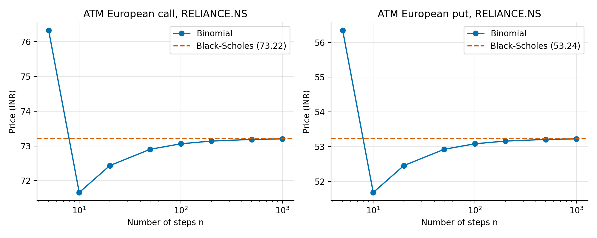
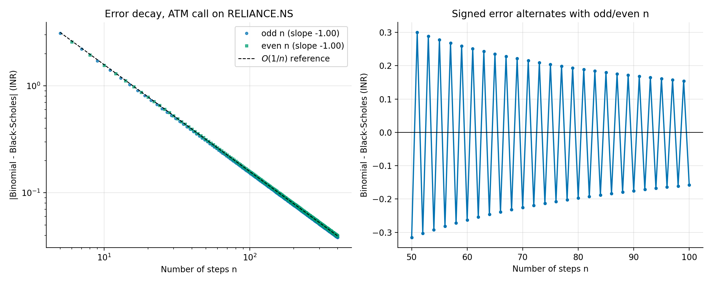
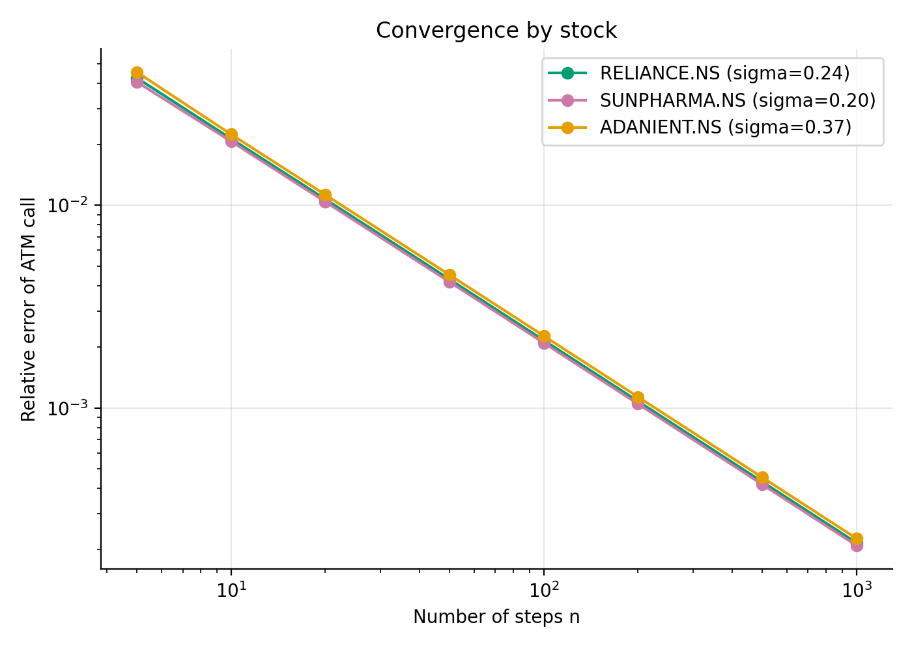
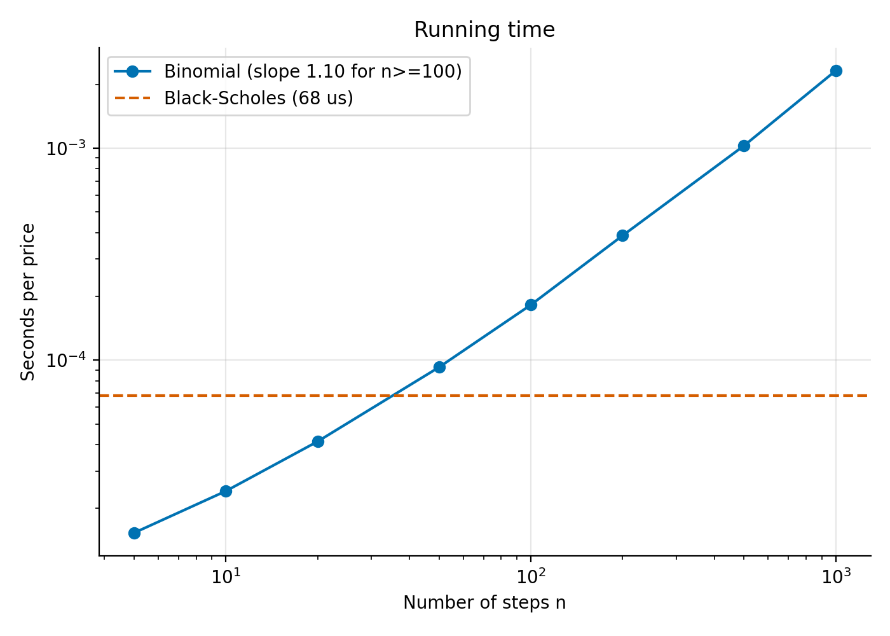

# European Option Pricing: Binomial Trees vs Black–Scholes

MAC F244 project. We price European calls and puts on three NSE-listed stocks with two methods, the **Black–Scholes (BS) formula** and the **Cox–Ross–Rubinstein (CRR) binomial tree**, and compare how close they get, how that depends on the inputs, and how fast each one runs.

| Name | ID No. |
|---|---|
| Mohammad Zaid Agha | 2024ADPS0840G |
| Adwait Eklavya | 2024ADPS0825G |
| Shivank Mishra | 2024ADPS0823G |
| Aswin Sunderiyal | 2024ADPS0867G |
| Rayasam Venkata Pradyumn | 2024B5AD0973G |

This README is a short version of the full report ([`report/Report.pdf`](report/Report.pdf)). A file-by-file technical spec of the code is in [`desc.md`](desc.md).

## Headline results

- The binomial price converges to the BS price as the number of steps `n` grows, with error **O(1/n)** (fitted log–log slope −1.00).
- The error **alternates in sign** between odd and even `n`. This is a known property of the CRR tree, not a bug.
- At `n = 500` the binomial price is within about **0.04%** of BS for an at-the-money call on every stock tested.
- At fixed `n`, the error grows with volatility and with maturity (like √T) and depends irregularly on the strike.
- BS takes about **70 µs** per price. A 1000-step tree takes about **2.3 ms**, roughly **34×** longer.

## 1. The problem

A European option gives the right, but not the obligation, to buy (call) or sell (put) a stock at strike `K` on date `T`. The payoff is `max(S_T − K, 0)` for a call and `max(K − S_T, 0)` for a put. The question is what it should cost today.

- **Black–Scholes:** the stock moves continuously and the price is an explicit formula.
- **Binomial tree:** time is cut into `n` steps, the stock goes up or down at each step, and the price is found by working backwards from maturity.

The tree is built to approximate BS, so the two should agree when `n` is large.

## 2. The models

**Stock price.** Geometric Brownian motion under the risk-neutral measure, `dS = rS dt + σS dW`. So `ln(S_T/S0)` is normal with mean `(r − σ²/2)T` and variance `σ²T`.

**Black–Scholes** (`N` is the standard normal distribution function):

```
C  = S0·N(d1) − K·e^(−rT)·N(d2)
d1 = [ln(S0/K) + (r + σ²/2)·T] / (σ·√T),   d2 = d1 − σ·√T
P  = C − S0 + K·e^(−rT)            (put–call parity)
```

**Cox–Ross–Rubinstein tree.** With `Δt = T/n`:

```
u = e^(σ·√Δt),   d = 1/u,   p = (e^(rΔt) − d) / (u − d)
```

`p` is chosen so the expected one-step growth equals the risk-free growth. Because `d = 1/u` the tree recombines, so there are only `i + 1` distinct prices after `i` steps. Start from the payoffs at maturity and step back with

```
V(i, j) = e^(−rΔt) · [ p·V(i+1, j+1) + (1 − p)·V(i+1, j) ]
```

The option price is the value at the root.

**Why it converges.** After `n` steps `ln(S_T/S0)` is a scaled binomial variable. To first order its mean tends to `(r − σ²/2)T` and its variance to `σ²T`, which are exactly the GBM values, so by the central limit theorem the tree approaches Black–Scholes. In practice the error is about `c/n`, and it oscillates with the parity of `n` because the strike's position relative to the final tree prices changes with `n`.

## 3. Data and parameters

- **Stocks:** Reliance (`RELIANCE.NS`, the primary stock), Sun Pharma (`SUNPHARMA.NS`) and Adani Enterprises (`ADANIENT.NS`), chosen to span different volatilities. HDFC Bank was tried first but its volatility was almost the same as Reliance's.
- **Prices:** one year of daily adjusted closes from Yahoo Finance via `yfinance` (249 days up to 6 Nov 2026). The last close is `S0`.
- **Volatility:** `σ = std(daily log returns) × √252`. This is a historical volatility, not an implied one.
- **Risk-free rate:** the RBI 364-day T-bill yield of 6.29%, converted to a continuously compounded rate, `r = ln(1.0629) = 0.0610`. Both models use the same `r`.

  **Limitations of the rate:** `r` is a fixed constant, not downloaded with the prices. Yahoo Finance only carries US Treasury yields, which don't suit NSE stocks. We found no free, stable API for the Indian T-bill yield: the RBI publishes auction results on its website without an API (scraping would break whenever the page layout changes), and the monthly series on international sites lags by months. A failed automatic fetch could also silently change every result. So the default stays at 6.29%, and you can supply another yield with `--rate` (see section 9). The 364-day yield is also not matched to each option's maturity; a 91-day bill would suit the 3-month default better. Both models always get the same `r`, so the convergence results don't depend on it, but absolute prices shift a little.
- **Defaults:** `T = 0.25` years, strike `K = m·S0` (at the money means `m = 1`), `n = 500`. Stocks are compared by *relative* error because all prices scale with `S0`.

| Stock | S0 (INR) | σ |
|---|---:|---:|
| SUNPHARMA.NS | 1860.00 | 0.196 |
| RELIANCE.NS | 1320.00 | 0.240 |
| ADANIENT.NS | 2745.80 | 0.375 |

Prices are downloaded fresh on each run, so `S0` and `σ` shift slightly over time. The run used for this README and the report is recorded in `outputs/run_info.json`.

## 4. Implementation

Four Python scripts (Python 3.10, NumPy, SciPy, pandas, matplotlib, yfinance):

| File | Job |
|---|---|
| `data.py` | Downloads and validates prices, estimates `S0` and `σ`, holds `r`. A good download overwrites the CSV cache in `data/`; otherwise the cached CSV is used and the script says so. |
| `black_scholes.py` | The BS call and put. Vectorised, so a range of strikes or volatilities is priced in one call. |
| `binomial.py` | The CRR tree. Only the final layer of prices is built and rolled back with NumPy, so memory is O(n). |
| `compare.py` | Runs all experiments and writes every figure and table to `outputs/`. |

**Verification.** Each model has built-in self-tests: the textbook values (`S0 = K = 100`, `T = 1`, `r = 0.05`, `σ = 0.2` give call 10.4506 and put 5.5735), the tree within about 0.002 of BS at `n = 1000`, put–call parity, a hand-computed one-step tree, and sensible limits.

**Three-step example** (Reliance, at the money): `u = 1.0718`, `d = 0.9330`, `p = 0.519`. The tree gives 78.42 INR against 73.22 from BS. Three steps is crude, which motivates the next section.

## 5. Results

All results are for at-the-money Reliance options unless stated otherwise.

### Convergence

BS prices the call at 73.219 INR.

| n | Binomial call | Abs. error | Rel. error |
|---:|---:|---:|---:|
| 5 | 76.326 | 3.107 | 4.2% |
| 10 | 71.661 | 1.558 | 2.1% |
| 50 | 72.904 | 0.315 | 0.43% |
| 100 | 73.061 | 0.158 | 0.22% |
| 500 | 73.187 | 0.0316 | 0.043% |
| 1000 | 73.203 | 0.0158 | 0.022% |



The call and put errors are identical, because both models satisfy put–call parity (residuals are zero up to rounding).

### Rate of convergence and oscillation



On log–log axes the error is a straight line of slope −1.00 for both odd and even `n`, so it is O(1/n). At the money the *size* of the error is almost the same for odd and even `n`, but its **sign** alternates (right panel). Away from the money, the size also depends on the parity of `n`. So the error at one `n` is not a reliable guide to the error at `n ± 1`.

### Strike, volatility, maturity (at `n = 500`)

| Sweep | Range | Absolute call error |
|---|---|---|
| Strike | `K/S0` from 0.8 to 1.2 | 0.001 to 0.032 INR, irregular in `K` |
| Volatility | σ from 0.10 to 0.60 | 0.014 to 0.078 INR, roughly proportional to the option price |
| Maturity | `T` from 1 month to 1 year | 0.018 to 0.063 INR, a factor of about 3.5, close to √12 |

The call price falls and the put price rises with the strike, and both rise with volatility and maturity, as option theory predicts. The strike error is irregular because of where the strike sits relative to the final tree prices. Figures: [strike](outputs/figures/e3_strike.png), [volatility](outputs/figures/e4_volatility.png), [maturity](outputs/figures/e5_maturity.png).

### Different stocks

| Stock | σ | Call rel. error | Put rel. error |
|---|---:|---:|---:|
| SUNPHARMA.NS | 0.196 | 0.042% | 0.062% |
| RELIANCE.NS | 0.240 | 0.043% | 0.059% |
| ADANIENT.NS | 0.375 | 0.045% | 0.056% |



Rupee errors differ a lot because share prices differ. Relative errors are within about 12% of each other even though σ almost doubles. The call error rises slightly with σ and the put error falls slightly, because a put is relatively more expensive at high volatility. Within this set, convergence is governed by `n`, not by the company.

### Running time

| Method | Time per price |
|---|---:|
| Black–Scholes | 68 µs |
| Binomial, n = 5 | 15 µs |
| Binomial, n = 100 | 0.18 ms |
| Binomial, n = 500 | 1.0 ms |
| Binomial, n = 1000 | 2.3 ms |



The tree costs O(n²) in theory, but the fitted slope for `n ≥ 100` is only about 1.1. Each step is a single NumPy operation, so up to `n = 1000` the fixed Python overhead per step dominates. We expect the slope to approach 2 for much larger `n` but did not test it.

## 6. Discussion

- **Accuracy:** everything is consistent with first-order convergence. Halving the error means doubling `n`.
- **Speed vs flexibility:** for European options with constant `σ` and `r`, BS is exact within the model and about 34× cheaper than a 1000-step tree, so the tree has no advantage here. The tree's value is that the backward step can be modified, for example for early exercise or discrete dividends. We did not test such extensions.
- **What "error" means:** BS is the reference because it is exact under the GBM assumption. The error reported is the tree's discretisation error, not an error against real market option prices.
- **Untested ideas:** averaging the prices for `n` and `n + 1` should largely cancel the oscillation.

## 7. Limitations

- Constant volatility and rate. The rate is a fixed input (default 6.29%, overridable with `--rate`), not an automatically fetched current value, and it is not matched to each maturity. Adani in particular has news-driven shocks that GBM does not capture.
- Historical volatility from one year of prices, not implied volatility.
- Log-normal returns: thin tails, no jumps.
- European exercise only; dividends enter only through adjusted prices.
- Two models compared with each other; no market option prices were used.
- Three stocks and one date; timings depend on the machine.

## 8. Conclusion

The CRR tree converges to Black–Scholes at rate O(1/n) with an error that alternates in sign between odd and even `n`. At fixed `n` the error grows with volatility and √T and varies irregularly with the strike, while across stocks convergence depends mainly on `n`. For plain European options the Black–Scholes formula is both exact within the model and much faster, so the tree is mainly useful as a base for extensions the formula cannot handle.

## 9. Run it

Needs Python 3.10 (tested on Ubuntu 22.04). From the project folder:

```bash
python3 -m venv .venv
source .venv/bin/activate
pip install -r requirements.txt
python compare.py
```

`compare.py` downloads fresh prices (falling back to the CSVs in `data/` if Yahoo Finance is unavailable) and regenerates every figure and table in `outputs/`. To use a different risk-free yield (annual, in percent), add `--rate`. For example `python compare.py --rate 6.5` uses 6.5%. The default is 6.29% and the value must be in (0, 30]. The rate used is recorded per stock in `outputs/run_info.json`. Note that the numbers in this README and the report come from the default rate and the 6 Nov 2026 data, and a rerun downloads fresh prices, so they will shift.

Individual files can also be run to see their self-tests: `python black_scholes.py`, `python binomial.py`, `python data.py`.

## 10. Repository layout

```
data.py  black_scholes.py  binomial.py  compare.py   the code
data/                 cached price CSVs, one per stock
outputs/figures/      all figures (.pdf and .png)
outputs/tables/       all tables (.csv and .tex), plus outputs/run_info.json
report/               the full report (report.tex, refs.bib, Report.pdf)
desc.md               technical spec of every file
prd.md                project plan and decisions
```

## References

1. F. Black and M. Scholes, "The Pricing of Options and Corporate Liabilities", *Journal of Political Economy* 81(3), 1973.
2. J. C. Cox, S. A. Ross and M. Rubinstein, "Option Pricing: A Simplified Approach", *Journal of Financial Economics* 7(3), 1979.
3. J. C. Hull, *Options, Futures, and Other Derivatives*, 11th ed., Pearson, 2021.
4. D. P. J. Leisen and M. Reimer, "Binomial Models for Option Valuation: Examining and Improving Convergence", *Applied Mathematical Finance* 3(4), 1996.
5. Reserve Bank of India, Treasury Bill auction results (364-day yield of about 6.29%, October 2026).
